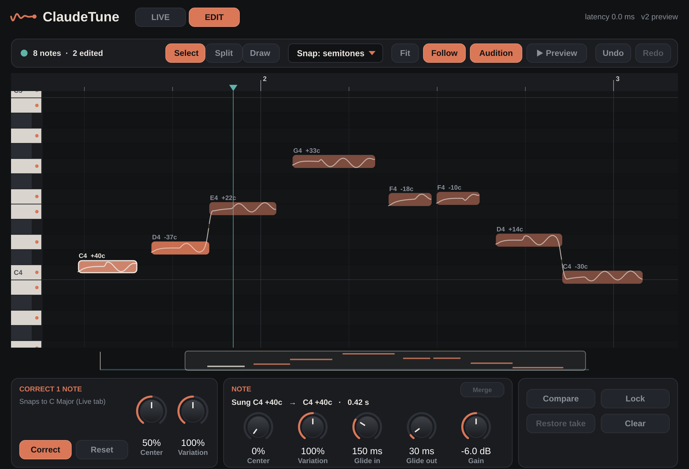

# ClaudeTune

Vocal pitch correction plug-in (VST3 / Audio Unit / standalone app) for macOS, built with JUCE.

* **Live tab** – real-time correction with the control set of a classic real-time vocal tuner.
* **Edit tab** *(2 preview)* – ClaudeTune captures the vocal as your DAW plays it, finds the notes,
  and plays your edits back in place, with zero latency.




---

## Install on your Mac

You have two options. Both produce the same plug-in.

### Option A — let GitHub build the installer (no tools needed on your Mac)

1. Create a new **private** repository on github.com (e.g. `claudetune`).
2. Upload everything in this folder to it (drag the files into the "uploading an existing file" page, or `git push`).
   The `.github` folder must be included.
3. Open the repository's **Actions** tab. The "Build ClaudeTune for macOS" workflow starts on its own
   (or press **Run workflow**). It takes about 10 minutes.
4. When it shows a green check, open the run and download **ClaudeTune-macOS** at the bottom of the page.
5. Unzip it and double-click `ClaudeTune-1.9.1-macOS.pkg`.
   - Because the installer isn't signed with a paid Apple Developer ID, macOS will say it can't verify it.
     **Right-click the .pkg → Open → Open**, or go to *System Settings → Privacy & Security* and click **Open Anyway**.
6. Restart your DAW (Logic: it rescans Audio Units on launch).

### Option B — build it on your Mac

```bash
xcode-select --install          # once, if you don't have the command line tools
brew install cmake              # or download CMake from cmake.org
cd ClaudeTune
./scripts/build_mac.sh
```

This builds a native binary, runs all the tests, and installs the VST3 + AU into
`~/Library/Audio/Plug-Ins`. The standalone app ends up in `build/ClaudeTune_artefacts/Release/Standalone/`.

### Where to find it

| DAW | Where |
|---|---|
| Logic Pro / GarageBand | Audio FX slot → Audio Units → ClaudeTune → ClaudeTune |
| Ableton Live, Reaper, Studio One, Cubase, Bitwig | VST3 → ClaudeTune |
| Standalone | /Applications/ClaudeTune.app (use it with a mic to try settings) |

For MIDI **Target Pitch** / **Reference Tone** in Logic, use the plug-in header's *Side Chain → MIDI* menu
to route a MIDI track into ClaudeTune. In Ableton, set a MIDI track's output to the vocal track's ClaudeTune.

---

## Edit tab (preview)

1. Put ClaudeTune **first** on the vocal track (before EQ, compression or effects) and click **EDIT**.
2. **Press play.** ClaudeTune records the vocal as Logic plays it — the status line shows *Capturing*.
   Notes appear in the overview a moment later. Play the whole vocal once, or just the part you want to edit;
   you can capture more later and the pieces join up.
3. Click **Correct** to snap every note to the key and scale set on the **Live** tab
   (or select some notes first to correct just those). **Center** pulls each note's drift to its centre,
   **Variation** keeps that much of the wobble and vibrato.
4. Fine-tune individual notes in the editor (below), then **press play** to hear the result.
   **Compare original** A/Bs your edits.

### The note editor

Notes are drawn where they will play, with the corrected pitch curve inside. When a note has been
moved, a faint outline shows where it was sung. The label above each note shows its pitch and how far
the singer was from it.

| To… | Do this |
|---|---|
| select a note | click it (shift- or cmd-click to add more) |
| select several | drag a rectangle across empty space; cmd+A selects all |
| retune | drag the note up or down (it snaps; hold **Option** to move freely) |
| snap a note onto pitch | double-click it |
| nudge pitch | ↑ / ↓ one semitone · shift+↑/↓ an octave · option+↑/↓ 10 cents |
| step through notes | ← / → |
| reset notes (pitch, shaping and timing) | Delete |
| zoom time / pitch | cmd+scroll or pinch / option+scroll · `+` `−` keys · **Fit** (F) |
| scroll | scroll wheel or trackpad; drag in the overview strip at the bottom |
| undo / redo | cmd+Z / shift+cmd+Z, or the toolbar buttons |
| play / stop in ClaudeTune | Return, or **▶ Play** in the header |
| switch tools | **1** Select · **2** Split · **3** Draw (or the toolbar) |
| cut a note in two | Split tool, click where to cut (a dashed line previews it) |
| join notes | select neighbours, press **M** (or **Merge**) |
| draw pitch by hand | Draw tool, drag across a note; hold **Option** to erase the drawing |
| move a note in time | drag it sideways (the drag locks to time or pitch after a few pixels); selected notes move together |
| snap timing to the grid | hold **Shift** while dragging (1/16 notes at the project tempo) |
| stretch or shorten a note | drag its left or right edge (the cursor changes); Shift snaps the edge |
| nudge timing | option+← / → 10 ms · shift+option+← / → 50 ms |

### Shaping notes

Select one or more notes and use the **Note** panel. Each knob drag is one undo step; double-click
a knob to reset it.

Timing edits time-stretch the audio rather than cutting it. Notes sung legato keep their shared
edge together when one of them moves. A note can't be pushed past its
neighbour.

| Knob | What it does |
|---|---|
| **Center** | pulls the note's slow drift onto its centre (0% = untouched) |
| **Variation** | keeps this much of the fast wobble and vibrato (0% flat, 100% natural, 200% exaggerated) |
| **Glide in / out** | how long the pitch takes to slide into and out of the note |
| **Gain** | makes the note louder or quieter (−24 to +12 dB) |

Hand-drawn pitch replaces everything else on the frames you draw over and blends into the
surrounding pitch over ~40 ms at each end, so strokes don't jump.

**Snap** in the toolbar chooses what a dragged note lands on: semitones, notes of the scale, or nothing.
The ruler shows bars and beats from Logic's tempo once you've pressed play.

**Playing in ClaudeTune (hearing just this vocal, with edits).** The **▶ Play** button in the header
plays the captured vocal on its own, inside ClaudeTune, while Logic is stopped. It starts from the
**teal marker** in the editor:

* The teal marker follows Logic's playhead, so after you stop Logic, Play picks up where Logic stopped.
* Click the editor's ruler to move the marker (or click empty space in the roll). Double-click the ruler
  to play from that spot. Clicking the ruler while it plays jumps there.
* Press **Return** to start or stop. **Space belongs to Logic**: Logic keeps that key for its own
  transport even when the ClaudeTune window is in front, so Space always plays the whole song in Logic.
* With **Audition** on, holding the mouse on a note loops just that note, so you hear changes as you drag.
* When Logic plays, it takes over: ClaudeTune's Play steps aside and you hear your edits in place in the
  song. Logic's playhead is the white line; when it's parked somewhere other than the teal marker it shows
  as a dashed line labelled "Logic".
* Logic only runs plug-ins on the **selected** track while it's stopped. If Play doesn't move, the
  header says "Select this track in Logic to hear it".

The line under the piano roll always says what a click or drag would do where the mouse is, and the
toolbar buttons have tooltips with their shortcuts.

What ClaudeTune does on later passes:

| You… | ClaudeTune… |
|---|---|
| play the same audio again | applies your edits (the region gain/fader before it can change freely) |
| replace or re-record part of the vocal | plays the new audio untouched, captures it, keeps edits everywhere else. **Restore previous take** brings the old audio and edits back |
| mute or delete part of the region | plays the silence and keeps the old capture and edits |
| click **Lock capture** | stops capturing: changed audio plays untouched and is never recorded |
| bounce / export | renders the edits (offline bounces wait for capture to keep up) |

The capture is saved **inside the Logic project** (lossless 24-bit FLAC plus the analysis), so edits come back
when you reopen it. A 3-minute mono vocal adds around 10–15 MB to the project.

**Good to know**

* Edit mode reports 0 ms latency. Switching tabs changes the latency Logic compensates for, so stop playback first.
* The project's sample rate must stay the one the vocal was captured at; ClaudeTune passes audio through
  untouched (and says so) if it changes.
* Logic only sends audio while playing. Regions you never play are never captured.
* Dragging notes in time (moving and stretching) comes next; the engine for it is already in and tested.
* Keyboard shortcuts need the ClaudeTune window to have focus (click in the editor first). Space always
  goes to Logic.

---

## Live tab controls

| Control | What it does | Range (default) |
|---|---|---|
| **Speed** | How fast a drifting sustained note is pulled onto the target. Faster flattens more of the natural movement. | 0.1–800 ms, log (15 ms) |
| **Note Transition** | How fast correction moves when the target note changes. Fast = quantised "hard-tune" steps, slow = smooth glides with tight sustain. | 0.1–800 ms, log (120 ms) |
| **Link** | Dragging Speed or Note Transition moves the other by the same ratio. | On/Off (Off) |
| **Tolerance – Cents** | Extra margin past the 50-cent midpoint before the target may change (10 → the voice must be 60 c away). Stops flipping between neighbouring notes. | Off–40 (Off) |
| **Tolerance – Time** | The voice must sit past the midpoint this long before the target changes. Either tolerance can trigger the change. | Off–300 ms (Off) |
| **Vibrato On/Off** | On: the vibrato centre is corrected and natural vibrato is kept separately, even at fast speeds. Note decisions follow the vibrato centre, so a wide vibrato never flips notes. | (Off) |
| **Vibrato Depth** | Scales natural vibrato: 0% flattens, 100% keeps, 200% exaggerates. | 0–200% (100%) |
| **Correction On/Off** | Enables or bypasses correction (10 ms crossfade, latency stays constant). | (On) |
| **Correction Amount** | How much of the correction is applied. 50% turns +40 c into +20 c. | 0.1–100% (100%) |
| **Formant** | *Corrected* keeps the voice's natural resonances (PSOLA). *Shifted* resamples, so formants move with pitch — the chipmunk/robot pitch-shifter sound. | (Corrected) |
| **Correction meter** | Target note, cents of correction (e.g. "34 cents down"), and the sung pitch. | |
| **IN / OUT meters** | Peak level, −28 to 0 dBFS. | |
| **Keyboard grid** | Click a note's cell to cycle: **Legal** (orange, a valid target) → **Illegal** (outline, goes to nearest legal) → **Illegal ▲** (goes to nearest legal above) → **Illegal ▼** (nearest legal below) → **Bypass** (teal B, left uncorrected) → Legal. Shift-click or right-click cycles backwards. | |
| **Group Octaves** | Edits on the grid apply to that note in every octave. | (On) |
| **Range edges** | Drag the orange handles on the keyboard to set the detection range. Notes outside it are left alone. | C1–C7 |
| **Vocal range presets** | Bass, Baritone, Tenor, Alto, Mezzo Soprano, Soprano, Generic. | (Generic) |
| **Key & Scale** | Root plus 15 scales: Chromatic, Major, three minors, pentatonics, Blues, the modes, Whole Tone, and User (all notes start illegal). "* scale edited" shows after grid edits. | (C Chromatic) |
| **♯ / ♭** | Shows note names with sharps or flats. | |
| **Reset Scale** | Discards grid edits and restores the selected scale. | |
| **Reference (A4)** | Tuning reference, ±100 cents. | 415.30–466.16 Hz (440) |
| **Reference Tone** | Incoming MIDI notes play a guide tone mixed into the output. | |
| **Target Pitch** | Incoming MIDI notes become the target; the vocal is moved to the played note (Speed/Transition set the glide). Works on bypassed notes, not outside Range. With no note held, the scale is used. | |
| **Level** | Reference tone level. | −18 to +18 dB (0) |

Every control is automatable, and the grid edits are saved with your session.

## Latency

The pitch shifter needs about two cycles of the lowest note it may have to correct, so latency follows the
**Range** setting (your DAW compensates automatically on playback):

| Range | Latency |
|---|---|
| Soprano | 12.5 ms |
| Mezzo Soprano | 15 ms |
| Alto | 17 ms |
| Tenor | 22 ms |
| Baritone | 30 ms |
| Bass / Generic | 39 ms |

For live monitoring while tracking, pick the narrowest range that covers the singer.

## How it works

### Live tab

1. **Pitch detection** — YIN with an FFT-computed autocorrelation, every ~2.7 ms, on the newest audio. It looks an
   octave below the range so low notes aren't mistaken for harmonics; a 3-point median removes octave glitches.
2. **Target logic** — note grid → legal target (with tolerance), or the held MIDI note in Target Pitch mode.
3. **Smoothing** — Note Transition glides the target, Speed glides the correction, the vibrato centre is a moving
   average over one vibrato cycle.
4. **Shifting** — pitch-synchronous overlap-add (PSOLA). Analysis marks are locked to the waveform with
   sub-sample precision; synthesis grains are spaced at the desired output period, which is keyed to the exact
   input time each grain carries.

The engine (`Source/Engine`) has no JUCE dependency. `Tests/EngineTests.cpp` checks correction accuracy,
scales, note states, tolerance, vibrato, bypass, MIDI target, formant mode, stereo and CPU at 44.1/48/96 kHz.

### Edit tab

1. **Capture** — on the audio thread, every block is compared with what was captured at that timeline
   position, in ~1.3 ms windows. New audio goes to a lock-free FIFO; a background worker adds it to the
   document. A difference only counts as a re-take after it lasts 20 ms, and a short look-back buffer makes
   sure the re-take is still captured from its first sample.
2. **Analysis** — offline YIN with several candidates per frame and a Viterbi path (no octave jumps),
   then note segmentation at pitch changes and loudness dips. New audio is analysed locally, in about 25 ms
   per 0.75 s, and edits on notes whose audio didn't change are carried over.
3. **Rendering** — PSOLA with pitch marks locked to the waveform, timing edits through a time map.
   Untouched audio is copied bit-for-bit; edited regions are re-rendered incrementally (~5–10 ms per edit).
4. **Playback** — rendered audio is published as immutable chunks (no locks, no allocation on the audio
   thread) and applied as a *difference* on top of the live input, so unedited audio stays identical and
   gain changes before the plug-in carry through.

`Tests/EditTests.cpp` covers analysis, segmentation and every edit type; `Tests/SessionTests.cpp` drives
the capture system like a DAW (re-takes, mutes, loops, gain changes, save/restore, editing while playing,
preview playback). `Tools/EditorTest.cpp` drives the note editor with synthetic mouse and keyboard input.

## Project layout

```
Source/Engine/     Live DSP: FFT, YIN detector, scales, TuneEngine (PSOLA)
Source/Edit/       Edit DSP: analysis, segmentation, edit model, renderer, capture session
Source/UI/         look-and-feel, tuner, meters, keyboard grid, Edit page, note editor
Source/Plugin*     JUCE processor (parameters, state, MIDI, modes) and editor
Source/SessionCodec*  capture storage in the project (FLAC + analysis)
Tests/             engine, edit and session tests (no JUCE needed)
Tools/             UI snapshot, end-to-end plug-in test, VST3 host test, editor interaction test
scripts/           build_mac.sh
packaging/mac/     installer definition
.github/workflows/ macOS build + .pkg installer
```

## Roadmap

1. ~~Offline analysis and render engine~~
2. ~~Capture in the DAW, change detection, project storage~~
3. ~~Note editor: zoomable piano roll, click/drag notes, playback from the cursor~~
4. ~~Per-note tools: pitch, Center, Variation, transitions, gain, split/merge, pitch pencil, undo~~
5. ~~Timing edits in the editor (move/stretch notes)~~
6. Polish
