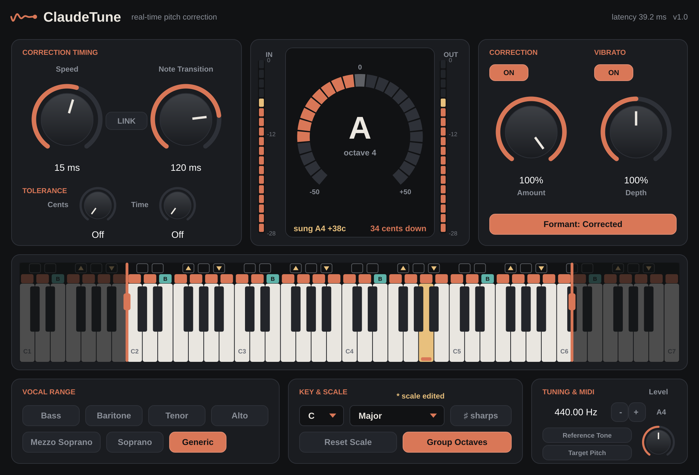

# ClaudeTune

Real-time vocal pitch correction plug-in (VST3 / Audio Unit / standalone app) for macOS, built with JUCE.
It mirrors the control set of a classic real-time vocal tuner, with its own engine and its own interface.



---

## Install on your Mac

You have two options. Both produce the same plug-in.

### Option A — let GitHub build the installer (no tools needed on your Mac)

1. Create a new **private** repository on github.com (e.g. `claudetune`).
2. Upload everything in this folder to it (drag the files into the "uploading an existing file" page, or `git push`).
   The `.github` folder must be included.
3. Open the repository's **Actions** tab. The "Build ClaudeTune for macOS" workflow starts on its own
   (or press **Run workflow**). It takes about 10 minutes.
4. When it shows a green check, open the run and download **ClaudeTune-macOS** at the bottom of the page.
5. Unzip it and double-click `ClaudeTune-1.0.0-macOS.pkg`.
   - Because the installer isn't signed with a paid Apple Developer ID, macOS will say it can't verify it.
     **Right-click the .pkg → Open → Open**, or go to *System Settings → Privacy & Security* and click **Open Anyway**.
6. Restart your DAW (Logic: it rescans Audio Units on launch).

### Option B — build it on your Mac

```bash
xcode-select --install          # once, if you don't have the command line tools
brew install cmake              # or download CMake from cmake.org
cd ClaudeTune
./scripts/build_mac.sh
```

This builds a native binary, runs the engine tests, and installs the VST3 + AU into
`~/Library/Audio/Plug-Ins`. The standalone app ends up in `build/ClaudeTune_artefacts/Release/Standalone/`.

### Where to find it

| DAW | Where |
|---|---|
| Logic Pro / GarageBand | Audio FX slot → Audio Units → ClaudeTune → ClaudeTune |
| Ableton Live, Reaper, Studio One, Cubase, Bitwig | VST3 → ClaudeTune |
| Standalone | /Applications/ClaudeTune.app (use it with a mic to try settings) |

For MIDI **Target Pitch** / **Reference Tone** in Logic, use the plug-in header's *Side Chain → MIDI* menu
to route a MIDI track into ClaudeTune. In Ableton, set a MIDI track's output to the vocal track's ClaudeTune.

---

## Controls

| Control | What it does | Range (default) |
|---|---|---|
| **Speed** | How fast a drifting sustained note is pulled onto the target. Faster flattens more of the natural movement. | 0.1–800 ms, log (15 ms) |
| **Note Transition** | How fast correction moves when the target note changes. Fast = quantised "hard-tune" steps, slow = smooth glides with tight sustain. | 0.1–800 ms, log (120 ms) |
| **Link** | Dragging Speed or Note Transition moves the other by the same ratio. | On/Off (Off) |
| **Tolerance – Cents** | Extra margin past the 50-cent midpoint before the target may change (10 → the voice must be 60 c away). Stops flipping between neighbouring notes. | Off–40 (Off) |
| **Tolerance – Time** | The voice must sit past the midpoint this long before the target changes. Either tolerance can trigger the change. | Off–300 ms (Off) |
| **Vibrato On/Off** | On: the vibrato centre is corrected and natural vibrato is kept separately, even at fast speeds. Note decisions follow the vibrato centre, so a wide vibrato never flips notes. | (Off) |
| **Vibrato Depth** | Scales natural vibrato: 0% flattens, 100% keeps, 200% exaggerates. | 0–200% (100%) |
| **Correction On/Off** | Enables or bypasses correction (10 ms crossfade, latency stays constant). | (On) |
| **Correction Amount** | How much of the correction is applied. 50% turns +40 c into +20 c. | 0.1–100% (100%) |
| **Formant** | *Corrected* keeps the voice's natural resonances (PSOLA). *Shifted* resamples, so formants move with pitch — the chipmunk/robot pitch-shifter sound. | (Corrected) |
| **Correction meter** | Target note, cents of correction (e.g. "34 cents down"), and the sung pitch. | |
| **IN / OUT meters** | Peak level, −28 to 0 dBFS. | |
| **Keyboard grid** | Click a note's cell to cycle: **Legal** (orange, a valid target) → **Illegal** (outline, goes to nearest legal) → **Illegal ▲** (goes to nearest legal above) → **Illegal ▼** (nearest legal below) → **Bypass** (teal B, left uncorrected) → Legal. Shift-click or right-click cycles backwards. | |
| **Group Octaves** | Edits on the grid apply to that note in every octave. | (On) |
| **Range edges** | Drag the orange handles on the keyboard to set the detection range. Notes outside it are left alone. | C1–C7 |
| **Vocal range presets** | Bass, Baritone, Tenor, Alto, Mezzo Soprano, Soprano, Generic. | (Generic) |
| **Key & Scale** | Root plus 15 scales: Chromatic, Major, three minors, pentatonics, Blues, the modes, Whole Tone, and User (all notes start illegal). "* scale edited" shows after grid edits. | (C Chromatic) |
| **♯ / ♭** | Shows note names with sharps or flats. | |
| **Reset Scale** | Discards grid edits and restores the selected scale. | |
| **Reference (A4)** | Tuning reference, ±100 cents. | 415.30–466.16 Hz (440) |
| **Reference Tone** | Incoming MIDI notes play a guide tone mixed into the output. | |
| **Target Pitch** | Incoming MIDI notes become the target; the vocal is moved to the played note (Speed/Transition set the glide). Works on bypassed notes, not outside Range. With no note held, the scale is used. | |
| **Level** | Reference tone level. | −18 to +18 dB (0) |

Every control is automatable, and the grid edits are saved with your session.

## Latency

The pitch shifter needs about two cycles of the lowest note it may have to correct, so latency follows the
**Range** setting (your DAW compensates automatically on playback):

| Range | Latency |
|---|---|
| Soprano | 12.5 ms |
| Mezzo Soprano | 15 ms |
| Alto | 17 ms |
| Tenor | 22 ms |
| Baritone | 30 ms |
| Bass / Generic | 39 ms |

For live monitoring while tracking, pick the narrowest range that covers the singer.

## How it works

1. **Pitch detection** — YIN with an FFT-computed autocorrelation, every ~2.7 ms, on the newest audio. It looks an
   octave below the range so low notes aren't mistaken for harmonics; a 3-point median removes octave glitches.
2. **Target logic** — note grid → legal target (with tolerance), or the held MIDI note in Target Pitch mode.
3. **Smoothing** — Note Transition glides the target, Speed glides the correction, the vibrato centre is a moving
   average over one vibrato cycle.
4. **Shifting** — pitch-synchronous overlap-add (PSOLA). Analysis marks are locked to the waveform with
   sub-sample precision; synthesis grains are spaced at the desired output period, which is keyed to the exact
   input time each grain carries.

The engine (`Source/Engine`) has no JUCE dependency. `Tests/EngineTests.cpp` checks correction accuracy,
scales, note states, tolerance, vibrato, bypass, MIDI target, formant mode, stereo and CPU at 44.1/48/96 kHz.

## Project layout

```
Source/Engine/     DSP: FFT, YIN detector, scales, TuneEngine (PSOLA)
Source/UI/         look-and-feel, tuner, meters, keyboard grid
Source/Plugin*     JUCE processor (parameters, state, MIDI) and editor
Tests/             engine tests (also renders demo WAVs: ./ClaudeTuneEngineTests <folder>)
Tools/             headless UI snapshot tool
scripts/           build_mac.sh
packaging/mac/     installer definition
.github/workflows/ macOS build + .pkg installer
```

## Next: graphical editor

The engine already exposes everything a graphical (offline) editor needs: per-hop detected pitch, target notes
and a correction curve keyed to input time. A graphical mode would record the detected pitch of a take,
show it as note blobs, and let you draw the output-pitch curve that the PSOLA stage already follows.
